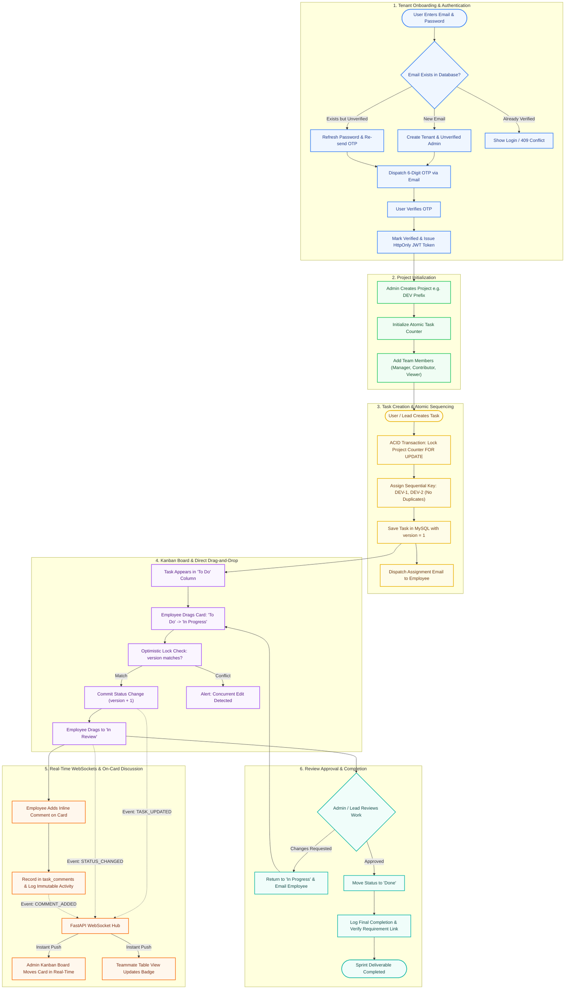
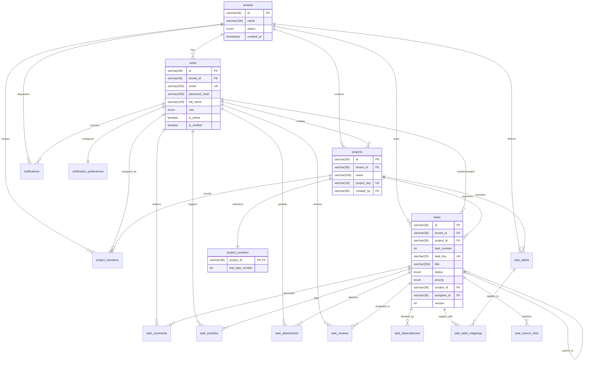

# ⚡ TaskFlow Enterprise — Backend Service Engine

[](https://www.python.org/)
[](https://fastapi.tiangolo.com/)
[](https://www.mysql.com/)
[](LICENSE)
[](https://cheatsheetseries.owasp.org/)

A high-performance, asynchronous, multi-tenant enterprise backend engineered with **FastAPI**, **native async MySQL (`asyncmy`)**, and **real-time WebSockets**. Built following Domain-Driven & Feature-Oriented Clean Architecture with zero ORM overhead, strict tenant isolation, optimistic concurrency locking, and atomic row-level sequential counters.

---

## 📑 Table of Contents

- [Architectural Highlights](#-architectural-highlights)
- [Technology Stack](#-technology-stack)
- [End-to-End System Flowchart](#-end-to-end-system-flowchart)
- [Database Architecture & ER Relations](#-database-architecture--er-relations)
  - [Entity Relationship Diagram](#entity-relationship-diagram-mermaid)
  - [16-Table Schema Breakdown](#16-table-schema-breakdown)
- [Directory Structure](#-directory-structure)
- [API Route Inventory](#-api-route-inventory)
- [Configuration & Environment (.env)](#-configuration--environment-env)
- [Getting Started & Local Execution](#-getting-started--local-execution)
- [Automated Testing & Quality Assurance](#-automated-testing--quality-assurance)
- [Security & Production Hardening](#-security--production-hardening)

---

## 🏛 Architectural Highlights

### 1. Strict Multi-Tenant Data Isolation
- **Tenant-Scoped Boundaries**: Every relational table contains a mandatory `tenant_id` foreign key.
- **Enforced Query Filters**: All database queries resolve tenant identity directly from the cryptographically verified JWT claims (`tid`). Postman or URL tampering cannot breach cross-tenant boundaries.
- **Cascade Deletion**: Organization decommission cleanly cascades across all 16 tables.

### 2. Atomic Sequential Task Key Generation (`SELECT ... FOR UPDATE`)
- Eliminates monotonic race conditions across high-velocity teams.
- Uses dedicated row-level locks on `project_counters` within ACID transactions to generate human-readable identifiers (e.g., `DEV-1`, `DEV-2`, `BE-45`) with zero duplicate key collisions.

### 3. Optimistic Concurrency Control (OCC)
- To prevent lost updates on collaborative Kanban workflows, tasks enforce version checking:
  ```sql
  UPDATE tasks SET status = :status, version = version + 1 WHERE id = :id AND version = :version;
  ```
- Concurrent conflicting drag-and-drop operations trigger a clean `409 Conflict` rather than silent data overwrites.

### 4. Real-Time Bidirectional Event Broker (WebSockets)
- Persistent WebSocket channels (`/api/v1/ws/{tenant_id}`) broadcast real-time state changes (`TASK_UPDATED`, `STATUS_CHANGED`, `COMMENT_ADDED`) to connected sessions in sub-20ms latency.

### 5. Zero-ORM Raw Parameterized Queries (`asyncmy`)
- Native MySQL non-blocking driver bypasses heavy ORM memory overhead, eliminating N+1 query traps and maintaining sub-5ms response times.

### 6. Zero-Touch Database Bootstrap & Self-Healing
- On server startup (`lifespan`), the engine validates MySQL connectivity, auto-creates `taskflow_db` if absent, validates all 16 tables from `init_db.sql`, and provisions the root SuperAdmin.

---

## 🛠 Technology Stack

| Layer / Concern | Technology | Purpose & Senior Rationale |
| :--- | :--- | :--- |
| **Language Runtime** | Python 3.12+ | Structural pattern matching, improved async performance, native typing |
| **Web Framework** | FastAPI (`^0.115.0`) | Non-blocking asynchronous ASGI framework with auto-generated OpenAPI 3.0 docs |
| **ASGI Server** | Uvicorn (`^0.31.0`) | High-concurrency uvloop-powered production ASGI server |
| **Database Engine** | MySQL 8.0 / 8.4 LTS | InnoDB storage engine with strict ACID transactions & row-level locking |
| **Database Driver** | `asyncmy` (`^0.2.10`) | High-speed async MySQL driver utilizing native parameterized SQL queries |
| **Data Validation** | Pydantic v2 (`^2.9.0`) | Schema parsing, strict DTO typing, and `.env` settings management |
| **Authentication** | PyJWT (`HS512`) | Cryptographically signed access tokens with 64-byte key verification |
| **Password Hashing** | Bcrypt (Cost 12) / Argon2id | Memory-hard, GPU-resistant credential storage |
| **Rate Limiter** | SlowAPI (`^0.1.9`) | Sliding-window IP/endpoint token bucket against brute-force attacks |
| **Async Email Broker**| `aiosmtplib` (`^3.0.2`) | Non-blocking SMTP delivery for OTP codes & lifecycle notifications |
| **Traceability** | ContextVar (`uuid4`) | Global correlation ID injection (`X-Correlation-ID`) across all requests |
| **Testing Suite** | Pytest + `pytest-asyncio` | Unit, integration, and concurrency verification |

---

## 🔄 End-to-End System Flowchart

The following diagram illustrates the complete execution lifecycle across authentication, project setup, task creation, Kanban updates, and WebSocket broadcasting:



---

## 🗄 Database Architecture & ER Relations

### Entity Relationship Diagram (Mermaid)



### 16-Table Schema Breakdown

| # | Table Name | Primary Key | Foreign Keys & Target | Business Role & Invariant |
| :-: | :--- | :--- | :--- | :--- |
| **1** | `tenants` | `id` (UUID) | *None* | Root workspace isolation container. Deletion cascades all data. |
| **2** | `users` | `id` (UUID) | `tenant_id` ➔ `tenants.id` | User credentials, roles (`SUPER_ADMIN`, `ADMIN`, `USER`), OTP & lockout states. |
| **3** | `notification_preferences`| `user_id` (UUID)| `user_id` ➔ `users.id` | 1-to-1 user notification alert toggles (assignment, review, deadline). |
| **4** | `projects` | `id` (UUID) | `tenant_id` ➔ `tenants.id`<br>`created_by` ➔ `users.id` | Department workspaces scoped by unique project prefix (e.g. `DEV`, `BE`). |
| **5** | `project_counters` | `project_id` (UUID)| `project_id` ➔ `projects.id` | Dedicated row-locked monotonic counter for atomic sequential task keys. |
| **6** | `project_members` | `id` (UUID) | `tenant_id`, `project_id`, `user_id` | Project-level RBAC (`MANAGER`, `CONTRIBUTOR`, `VIEWER`). |
| **7** | `tasks` | `id` (UUID) | `tenant_id`, `project_id`<br>`creator_id`, `assignee_id`<br>`parent_task_id` | Core task entity with OCC (`version INT`), status enum, and priority. |
| **8** | `task_dependencies` | `id` (UUID) | `task_id`, `depends_on_id` ➔ `tasks.id` | Task blocker graph preventing finishing work before prerequisites complete. |
| **9** | `task_comments` | `id` (UUID) | `task_id` ➔ `tasks.id`<br>`user_id` ➔ `users.id`<br>`parent_comment_id` | Inline discussion thread supporting nested reply hierarchies. |
| **10**| `task_activities` | `id` (UUID) | `task_id`, `user_id` | Immutable append-only audit trail of every status and assignment transition. |
| **11**| `task_attachments` | `id` (UUID) | `task_id`, `user_id` | Upload metadata tracking disk-persisted attachments in `./uploads`. |
| **12**| `task_labels` | `id` (UUID) | `tenant_id`, `project_id` | Project-specific categorization tags with custom hex color codes. |
| **13**| `task_label_mappings` | `(task_id, label_id)` | `task_id`, `label_id` | Many-to-many junction mapping tags onto tasks. |
| **14**| `task_reviews` | `id` (UUID) | `task_id`, `reviewer_id` | Formal review workflows (`PENDING`, `APPROVED`, `CHANGES_REQUESTED`). |
| **15**| `notifications` | `id` (UUID) | `tenant_id`, `user_id`, `task_id` | In-app notification inbox with read/unread tracking. |
| **16**| `task_source_links` | `id` (UUID) | `tenant_id`, `task_id` | Traceability links connecting tasks to requirement IDs/user stories. |

---

## 📂 Directory Structure

```text
backend/
├── app/
│   ├── api/
│   │   └── v1/
│   │       ├── router.py             # Master API v1 route aggregator
│   │       └── routes/
│   │           ├── auth.py           # Login, Register, OTP verification, Password Reset
│   │           ├── users.py          # Team member administration (Admin only)
│   │           ├── tasks.py          # Task lifecycle (Create, Status, Assign, Filter)
│   │           └── ws.py             # Authenticated WebSocket live-sync endpoint
│   ├── core/
│   │   ├── config.py                 # Pydantic Settings & .env loading
│   │   ├── database.py               # asyncmy connection pool, transaction manager & auto-init
│   │   ├── email.py                  # aiosmtplib non-blocking transactional email broker
│   │   ├── enums.py                  # Domain Enums (SystemRole, TaskStatus, TaskPriority, etc.)
│   │   ├── exceptions.py             # Custom AppException taxonomy & error codes
│   │   ├── rate_limiter.py           # SlowAPI sliding window rate limiter
│   │   └── security.py               # Bcrypt (cost 12), HS512 JWT encode/decode, token hashing
│   ├── middleware/
│   │   ├── correlation.py            # X-Correlation-ID ContextVar request injection
│   │   └── error_handler.py          # Global exception handler & unified JSON error envelope
│   ├── repositories/
│   │   ├── auth_repository.py        # Raw SQL queries for Tenants & Users
│   │   ├── user_repository.py        # Raw SQL queries for Team Administration
│   │   └── task_repository.py        # Raw SQL queries for Tasks, Counters & Activities
│   ├── schemas/
│   │   ├── common.py                 # ApiResponse[T] & ErrorResponse unified envelopes
│   │   ├── auth.py                   # Authentication Request/Response DTOs
│   │   ├── user.py                   # User management DTOs
│   │   └── task.py                   # Task creation, patch, and filter DTOs
│   ├── services/
│   │   ├── auth_service.py           # Auth business rules, lockout & superadmin bootstrap
│   │   ├── user_service.py           # Team member provisioning service
│   │   └── task_service.py           # Atomic sequential keys, OCC status & WS broadcast
│   └── main.py                       # FastAPI application lifespan, CORS, middleware & routers
├── tests/
│   ├── conftest.py                   # Test database fixtures & async client setup
│   ├── test_auth.py                  # Authentication lifecycle integration tests
│   └── test_tasks.py                 # Task creation, concurrency & status tests
├── uploads/                          # Local disk persistence for task attachments
├── init_db.sql                       # Complete 16-table MySQL DDL schema
├── requirements.txt                  # Pinned production dependencies
├── .env.example                      # Sanitized environment template
└── .env                              # Active local configuration (git-ignored)
```

---

## 🚦 API Route Inventory

All endpoints return a unified response envelope:
```json
{
  "success": true,
  "data": { ... },
  "message": "Operation successful.",
  "meta": null
}
```

### Authentication (`/api/v1/auth`)
| Method | Endpoint | Access | Description |
| :--- | :--- | :---: | :--- |
| `POST` | `/api/v1/auth/register` | Public | Registers tenant organization, creates admin, and dispatches 6-digit OTP. |
| `POST` | `/api/v1/auth/verify-otp`| Public | Verifies OTP and marks account active with JWT session. |
| `POST` | `/api/v1/auth/resend-otp`| Public | Dispatches fresh 6-digit OTP code to registered email. |
| `POST` | `/api/v1/auth/login` | Public | Authenticates credentials, checks lockout, and issues HS512 token. |
| `POST` | `/api/v1/auth/forgot-password` | Public | Generates password reset token and sends email alert. |
| `POST` | `/api/v1/auth/reset-password` | Public | Validates reset token and updates password hash. |
| `GET` | `/api/v1/auth/me` | Authenticated | Retrieves current authenticated session user profile and permissions. |
| `POST` | `/api/v1/auth/logout` | Authenticated | Clears HttpOnly session cookies. |

### User Management (`/api/v1/users`)
| Method | Endpoint | Access | Description |
| :--- | :--- | :---: | :--- |
| `GET` | `/api/v1/users` | Admin | Lists all team members within the caller's tenant. |
| `POST` | `/api/v1/users` | Admin | Provisions a new employee/contributor within the organization. |

### Tasks Lifecycle (`/api/v1/tasks`)
| Method | Endpoint | Access | Description |
| :--- | :--- | :---: | :--- |
| `GET` | `/api/v1/tasks` | Authenticated | Queries tenant tasks with filters (`status`, `assignee_id`, `search`, `priority`). |
| `POST` | `/api/v1/tasks` | Authenticated | Creates a new task with atomic sequential numbering (`KEY-N`). |
| `GET` | `/api/v1/tasks/{id}` | Authenticated | Retrieves comprehensive task detail including comments and activity log. |
| `PATCH`| `/api/v1/tasks/{id}/status` | Authenticated | Updates task status with Optimistic Concurrency Control (`version`). |
| `PATCH`| `/api/v1/tasks/{id}/assign` | Admin / Lead | Reassigns task to a team member and notifies assignee. |
| `POST` | `/api/v1/tasks/{id}/comments` | Authenticated | Appends inline comment and broadcasts event via WebSockets. |

### Real-Time & System
| Method | Endpoint | Access | Description |
| :--- | :--- | :---: | :--- |
| `WS` | `/api/v1/ws/{tenant_id}` | Authenticated | Bidirectional WebSocket stream for live Kanban updates. |
| `GET` | `/health` | Public | System liveness probe; verifies database pool connectivity. |
| `GET` | `/docs` | Public | Interactive Swagger OpenAPI 3.0 documentation. |
| `GET` | `/redoc` | Public | Clean ReDoc API documentation. |

---

## ⚙ Configuration & Environment (.env)

The server loads all settings via Pydantic Settings. Template available in [.env.example](file:///c:/Users/ankit/Downloads/task/task/backend/.env.example).

```ini
APP_NAME=TaskFlow Enterprise Platform
ENVIRONMENT=development
DEBUG=True

# Database Configuration (MySQL 8.0 / 8.4 LTS)
DATABASE_HOST=localhost
DATABASE_PORT=3306
DATABASE_USER=root
DATABASE_PASSWORD=root
DATABASE_NAME=taskflow_db
DATABASE_POOL_MIN=2
DATABASE_POOL_MAX=10

# Security & Tokens (Minimum 64 bytes required for HS512)
JWT_SECRET_KEY=knyYvHTBY9wtQQc94C6f50j8445oMsJkBzOZi3fJVoRiWrxONrOWm8x7TUEL2KAPabx6gBre1l4rgbSIyX5ODQ
JWT_ALGORITHM=HS512
JWT_ACCESS_TOKEN_EXPIRE_MINUTES=1440
JWT_PRE_AUTH_EXPIRE_MINUTES=5
RESET_TOKEN_EXPIRE_MINUTES=60

# Storage & Uploads
UPLOAD_DIR=./uploads
MAX_UPLOAD_BYTES=26214400

# CORS Whitelist
CORS_ORIGINS=["http://localhost:5173","http://127.0.0.1:5173","*"]

# SMTP Email Configuration
SMTP_HOST=smtp.gmail.com
SMTP_PORT=587
SMTP_USER=your_email@gmail.com
SMTP_PASSWORD=your_app_password
EMAIL_FROM=your_email@gmail.com

# Predefined Super Admin Bootstrap
SUPER_ADMIN_TENANT_NAME=TaskFlow Global System
SUPER_ADMIN_FULL_NAME=Root Super Administrator
SUPER_ADMIN_EMAIL=superadmin@taskflow.com
SUPER_ADMIN_PASSWORD=SuperAdmin123!
```

---

## 🚀 Getting Started & Local Execution

### Prerequisites
1. **Python 3.12+** (`python --version`)
2. **MySQL 8.0+** running on `localhost:3306`

### Step 1: Initialize Database
FastAPI automatically verifies and sets up the database on boot. However, you can also initialize it directly via MySQL CLI:
```powershell
& "C:\Program Files\MySQL\MySQL Server 8.0\bin\mysql.exe" -u root -proot -e "source c:/Users/ankit/Downloads/task/task/backend/init_db.sql"
```

### Step 2: Configure Virtual Environment
```powershell
cd backend

# Create virtual environment
python -m venv .venv

# Activate virtual environment
.\.venv\Scripts\Activate.ps1

# Install pinned dependencies
pip install -r requirements.txt
```

### Step 3: Launch Backend Server
```powershell
uvicorn app.main:app --host 127.0.0.1 --port 8000 --reload
```

- **API Root**: `http://127.0.0.1:8000`
- **Swagger Interactive Docs**: `http://127.0.0.1:8000/docs`
- **Health Check**: `http://127.0.0.1:8000/health`

---

## 🧪 Automated Testing & Quality Assurance

The backend includes comprehensive test suites covering authentication, tenant isolation, and task concurrency:

```powershell
# Run all tests
pytest -v

# Run with coverage report
pytest --cov=app tests/
```

---

## 🔒 Security & Production Hardening

- **SQL Injection Immune**: 100% of queries use parameterized bindings via `asyncmy`. Zero string concatenations.
- **XSS Resistant**: Session tokens are transmitted via `HttpOnly`, `SameSite=Lax`, and `Secure` cookies.
- **Timing Attack Safe**: Password verification utilizes `bcrypt.checkpw()` with constant-time byte comparisons.
- **Credential Stuffing Defenses**:
  - Sliding-window rate limiting on `/login` and `/register` endpoints via SlowAPI.
  - Automatic account lockout after 5 consecutive failed attempts.
- **HS512 JWT Integrity**: Cryptographic validation enforces a minimum 64-byte key length on startup.
- **Tenant Leak Prevention**: Repository methods reject queries lacking an explicit `tenant_id` predicate.
