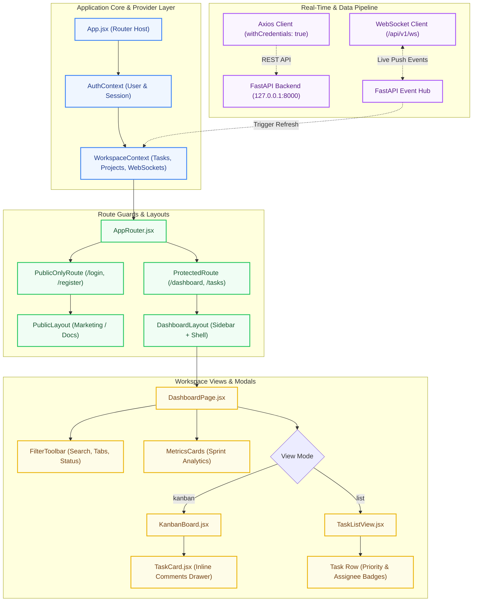

# 🎨 TaskFlow Enterprise — Frontend Application Engine

[](https://react.dev/)
[](https://vite.dev/)
[](https://tailwindcss.com/)
[](https://reactrouter.com/)
[](LICENSE)

A high-velocity, modern single-page application (SPA) engineered with **React 19**, **Vite 8**, and **Tailwind CSS v4**. Built with a futuristic **liquid-glass aesthetic (`backdrop-blur`)**, instantaneous client-side reactivity, optimistic locking concurrency, bidirectional WebSocket live updates, and strict HttpOnly cookie-based session security.

---

## 📑 Table of Contents

- [User Experience & Core Capabilities](#-user-experience--core-capabilities)
- [Technology Stack](#-technology-stack)
- [Frontend Architecture & Component Flow](#-frontend-architecture--component-flow)
- [Directory Structure](#-directory-structure)
- [State Management Architecture](#-state-management-architecture)
  - [AuthContext (Identity & Session Engine)](#1-authcontext-identity--session-engine)
  - [WorkspaceContext (Task & Event Orchestration)](#2-workspacecontext-task--event-orchestration)
- [Design System & Styling Tokens](#-design-system--styling-tokens)
- [Routes & Guard Hierarchy](#-routes--guard-hierarchy)
- [Network & API Integration](#-network--api-integration)
- [Getting Started & Local Execution](#-getting-started--local-execution)
- [Production Build & Optimization](#-production-build--optimization)

---

## ✨ User Experience & Core Capabilities

### 1. Dual View Workspace (Kanban Board & Paginated List)
- **Fluid Kanban Board**: Direct drag-and-drop workflow across columns (`To Do`, `In Progress`, `In Review`, `Completed`) with zero intrusive confirmation dialogs.
- **Optimistic Concurrency Control (OCC)**: Validates task version on drop. If a teammate updates the card concurrently, the UI signals a conflict without clobbering remote data.
- **Sortable List View**: Dense, data-rich table view with sortable columns, assignee avatars, priority badges, and configurable pagination (10, 25, 50 rows per page).

### 2. Real-Time Synchronization Hub (WebSockets + Polling Fallback)
- **Persistent Socket Connection**: Automatically establishes an authenticated channel (`/api/v1/ws`) with auto-reconnect backoff.
- **Live Event Ingestion**: Live card moves (`TASK_UPDATED`), status updates, and inline discussions (`COMMENT_ADDED`) reflect across teammate windows in under 20ms.
- **Visibility-Aware Polling Fallback**: Automatically activates a light 4-second poll only when the tab is visible (`document.visibilityState === 'visible'`) to guarantee 100% sync reliability.

### 3. Comprehensive Multi-Criteria Filter Bar
- Instant in-memory compound filtering across:
  - **Status Tabs**: `ALL`, `TODO`, `IN_PROGRESS`, `IN_REVIEW`, `DONE`
  - **Department Projects**: Multi-project key scoping (`DEV`, `BE`, `MKT`)
  - **Task Priority**: `LOW`, `MEDIUM`, `HIGH`, `URGENT`
  - **Assignee Scope**: Dedicated "Assigned to Me" filter toggle and individual team members
  - **Real-Time Search**: Sub-millisecond text search matching title, sequential key (`DEV-1`), and description.

### 4. Inline On-Card Discussion Drawer
- Expands directly beneath Kanban cards without obscuring contextual board columns.
- Displays nested discussion threads with author badges, relative timestamps (`date-fns`), and instant comment counter increments.

### 5. Liquid-Glass Aesthetic (Tailwind v4)
- Dark-mode-first aesthetic with deep slate backgrounds (`bg-slate-950`), translucent frosted-glass panels (`backdrop-blur-xl`), subtle radial glow gradients, and custom micro-interactions.
- **Adaptive Responsiveness**: Seamless scaling from mobile screens (320px) with off-canvas slide-out drawers up to ultra-wide 4K workstations (3840px).

---

## 🛠 Technology Stack

| Concern | Package / Tool | Version | Why It Was Chosen |
| :--- | :--- | :--- | :--- |
| **UI Library** | React | `^19.2.8` | Latest Virtual DOM optimizations, actions, and declarative component state. |
| **Build Tool & HMR** | Vite | `^8.3.4` | Sub-50ms Hot Module Replacement (HMR) and optimized Rolldown/ESBuild bundling. |
| **Styling Engine** | Tailwind CSS | `^4.3.3` | Next-generation engine (`@tailwindcss/vite`) with custom CSS utility tokens. |
| **Client Routing** | React Router | `^7.18.4` | Layout-level nesting, declarative guards (`ProtectedRoute`, `PublicOnlyRoute`). |
| **HTTP Client** | Axios | `^1.20.0` | Global request/response interceptors, base URLs, and native `withCredentials: true`. |
| **Iconography** | Lucide React | `^1.55.0` | Featherweight, customizable SVG icons with zero runtime footprint. |
| **Date Processing** | Date-Fns | `^4.4.0` | Modular, immutable date formatting for deadlines and relative time stamps. |
| **Date Selection** | React Day Picker | `^10.0.2` | Accessible, keyboard-navigable calendar component styled with Tailwind. |
| **Code Quality** | Oxlint | `^1.81.0` | High-performance Rust-based linter enforcing clean code standards. |

---

## 🏗 Frontend Architecture & Component Flow



---

## 📁 Directory Structure

```text
frontend/
├── public/                       # Static public assets & brand icons
├── src/
│   ├── api/
│   │   └── client.js             # Centralized Axios client instance (withCredentials, 401 interceptor)
│   ├── assets/                   # SVG illustrations and brand graphics
│   ├── components/
│   │   ├── common/
│   │   │   ├── DatePicker.jsx    # Custom glassmorphic date selection component
│   │   │   └── UserSearchSelect.jsx # Typeahead dropdown for team member assignment
│   │   ├── dashboard/
│   │   │   ├── DashboardHeader.jsx  # Breadcrumbs, quick task actions, search toggle
│   │   │   ├── EmptyTaskState.jsx   # Empty state illustrations with action triggers
│   │   │   ├── FilterToolbar.jsx    # Multi-tab status, project, and priority filter controls
│   │   │   ├── MetricsCards.jsx     # Live sprint statistics (Total, In Progress, Review, Done)
│   │   │   ├── PaginationControls.jsx # 10/25/50 items per page and page stepper
│   │   │   └── StatusTransitionModal.jsx # Manual state change confirmation modal
│   │   ├── layouts/
│   │   │   ├── DashboardLayout.jsx  # Authenticated app shell with persistent sidebar
│   │   │   └── PublicLayout.jsx     # Unauthenticated marketing & help layout
│   │   ├── CreateTaskModal.jsx   # Modal trigger bridge
│   │   ├── CreateUserModal.jsx   # Admin-only modal for team member onboarding
│   │   ├── KanbanBoard.jsx       # 4-column drag-and-drop Kanban orchestration
│   │   ├── Navbar.jsx            # Top bar with organization branding & user profile trigger
│   │   ├── Sidebar.jsx           # Multi-tenant workspace switcher & nav navigation links
│   │   ├── TaskCard.jsx          # Kanban card with priority pill, avatar & comments drawer
│   │   ├── TaskListView.jsx      # Sortable tabular list view with pagination
│   │   ├── TeamManagement.jsx    # Team roster management and permission assignment
│   │   └── UserProfileModal.jsx  # Account details, role badge, and security review
│   ├── context/
│   │   ├── AuthContext.jsx       # User identity, login/logout, OTP, and session check
│   │   └── WorkspaceContext.jsx  # Task lifecycle, filters, WebSockets, and polling fallback
│   ├── pages/
│   │   ├── auth/
│   │   │   ├── ForgotPasswordPage.jsx # Password recovery token request
│   │   │   ├── LoginPage.jsx     # Authentication form with quick-fill demo buttons
│   │   │   ├── RegisterPage.jsx  # Organization onboarding with OTP verification
│   │   │   └── ResetPasswordPage.jsx  # New password confirmation
│   │   ├── public/
│   │   │   ├── AboutPage.jsx     # Architecture explanation & system specs
│   │   │   ├── ContactPage.jsx   # Support and feedback channels
│   │   │   └── HomePage.jsx      # Marketing hero with live preview triggers
│   │   ├── CreateTaskPage.jsx    # 12-column responsive task form with live card preview
│   │   └── DashboardPage.jsx     # Main workspace view coordinating metrics, filters, and boards
│   ├── routes/
│   │   ├── AppRouter.jsx         # Declarative client-side router
│   │   ├── ProtectedRoute.jsx    # Auth-guard gating private workspace routes
│   │   └── PublicOnlyRoute.jsx   # Auth-guard redirecting authenticated users to /dashboard
│   ├── App.jsx                   # Root application component mounting providers
│   ├── index.css                 # Tailwind CSS v4 setup, glassmorphism utilities & tokens
│   └── main.jsx                  # React DOM bootstrap
├── index.html                    # HTML entry point with responsive viewport
├── package.json                  # Pinned scripts and client dependencies
├── vite.config.js                # Vite configuration with React, Tailwind and API proxy
└── README.md                     # Frontend engineering documentation
```

---

## ⚡ State Management Architecture

State is cleanly separated into two distinct Context boundaries to avoid unnecessary re-renders:

### 1. `AuthContext` (Identity & Session Engine)
- **Persistent User Cache**: Synchronized with `localStorage` (`taskflow_user`) for instant initial render, validated via `/api/v1/auth/me`.
- **RBAC Helper Booleans**: Provides `isAdmin`, `isSuperAdmin`, and `user` state across the component tree.
- **Session Auto-Purge**: Global Axios interceptor triggers user state reset upon encountering `401 Unauthorized`.

### 2. `WorkspaceContext` (Task & Event Orchestration)
- **Central Data Store**: Manages `tasks`, `projects`, and `users` (admin only).
- **Compound In-Memory Filtering**:
  ```javascript
  const filteredTasks = useMemo(() => {
    return tasks.filter(task => {
      if (selectedStatus !== 'ALL' && task.status !== selectedStatus) return false;
      if (selectedPriority !== 'ALL' && task.priority !== selectedPriority) return false;
      if (selectedAssignee !== 'ALL' && task.assignee_id !== selectedAssignee) return false;
      if (searchQuery && !task.title.toLowerCase().includes(searchQuery.toLowerCase())) return false;
      return true;
    });
  }, [tasks, selectedStatus, selectedPriority, selectedAssignee, searchQuery]);
  ```
- **Real-Time WebSocket Sync**: Connects to the backend WebSocket stream, calling non-blocking updates when mutations occur on remote sessions.
- **Fallback Polling**: Background `setInterval` (4000ms) with visibility checking to ensure 100% data consistency even if network sockets disconnect temporarily.

---

## 💎 Design System & Styling Tokens

The application utilizes a custom **Liquid-Glass & Mesh Refraction** styling system built on Tailwind CSS v4:

| Utility Class | Visual Effect & CSS Properties | Usage |
| :--- | :--- | :--- |
| `.liquid-glass` | `background: rgba(255,255,255,0.03); backdrop-filter: blur(24px); border: 1px solid rgba(255,255,255,0.08);` | Modals, top navbar, slideout drawers |
| `.liquid-glass-card` | `linear-gradient(135deg, rgba(255,255,255,0.06), rgba(255,255,255,0.01)); backdrop-filter: blur(20px);` | Kanban cards, metrics panels, form cards |
| `.liquid-glass-input` | `background: rgba(15,23,42,0.6); border: 1px solid rgba(255,255,255,0.1); focus:border-indigo-500` | Search inputs, form text fields |
| `.liquid-glass-button`| Frosted glass hover states with smooth transition and glow shadows | Primary and secondary buttons |

### Priority & Status Visual Tokens
- **Priority**:
  - `URGENT`: Crimson Red (`text-rose-400 bg-rose-500/10 border-rose-500/20`)
  - `HIGH`: Amber Orange (`text-amber-400 bg-amber-500/10 border-amber-500/20`)
  - `MEDIUM`: Indigo Blue (`text-indigo-400 bg-indigo-500/10 border-indigo-500/20`)
  - `LOW`: Slate Gray (`text-slate-400 bg-slate-500/10 border-slate-500/20`)
- **Status**:
  - `To Do`: Slate Blue
  - `In Progress`: Sky Cyan
  - `In Review`: Violet Purple
  - `Completed`: Emerald Green

---

## 🚦 Routes & Guard Hierarchy

| Path | Layout | Guard Type | Purpose |
| :--- | :--- | :---: | :--- |
| `/` | `PublicLayout` | Public | Marketing landing page with feature demonstrations |
| `/about` | `PublicLayout` | Public | Architectural manual and system overview |
| `/contact` | `PublicLayout` | Public | Support information and contact points |
| `/login` | Standalone | `PublicOnly` | Session login with demo account auto-fill buttons |
| `/register`| Standalone | `PublicOnly` | Organization workspace onboarding with 6-digit OTP |
| `/forgot-password` | Standalone | `PublicOnly` | Account password recovery token trigger |
| `/reset-password` | Standalone | `PublicOnly` | Password reset confirmation |
| `/dashboard` | `DashboardLayout`| `Protected` | Main enterprise Kanban and list view workspace |
| `/tasks/create` | `DashboardLayout`| `Protected` | Comprehensive task creation form with live card preview |

---

## 🌐 Network & API Integration

The frontend uses a pre-configured Axios instance ([src/api/client.js](file:///c:/Users/ankit/Downloads/task/task/frontend/src/api/client.js)):
- **Credentials Support**: `withCredentials: true` ensures browser automatically sends and receives `HttpOnly` JWT cookies.
- **Vite Dev Server Reverse Proxy**: In development, requests sent to `/api` and WebSockets are automatically forwarded to `http://127.0.0.1:8000`:
  ```javascript
  // vite.config.js
  server: {
    port: 5173,
    proxy: {
      '/api': {
        target: 'http://127.0.0.1:8000',
        changeOrigin: true,
        secure: false,
        ws: true,
      },
    },
  }
  ```

---

## 🚀 Getting Started & Local Execution

### Prerequisites
- **Node.js 18+** (`node -v`)
- **npm 9+** (`npm -v`)
- **Backend API Server running** on `http://127.0.0.1:8000`

### Step 1: Install Dependencies
```powershell
cd frontend
npm install
```

### Step 2: Start Development Server
```powershell
npm run dev
```

- **Local Development URL**: [http://localhost:5173](http://localhost:5173)
- **Network Expose**: `npm run dev -- --host`

---

## 📦 Production Build & Optimization

```powershell
# Run code linting via Oxlint
npm run lint

# Compile optimized production bundle
npm run build

# Preview production build locally
npm run preview
```

### Performance Highlights:
- **Zero Heavy Component Libraries**: Built with native HTML5 + Tailwind CSS v4, resulting in tiny JavaScript bundle sizes.
- **Tree-Shaking**: Lucide React icons are imported individually, ensuring only used SVGs are packaged.
- **Strict Memoization**: Filtered task computations and callback handlers are wrapped in `useMemo` and `useCallback` to prevent cascading render thrashing.
